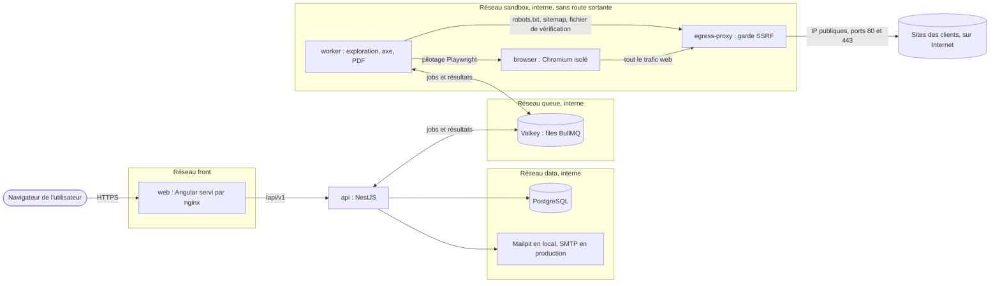

# Rampe — plan de réalisation du MVP

**État :** plan et décisions D1 à D10 validés le 14 octobre 2026. Jalons J0 et J1 validés et fusionnés dans `main`. Jalon J2 réalisé, en attente de validation.
**Référence :** [docs/CAHIER-DES-CHARGES.md](docs/CAHIER-DES-CHARGES.md), texte intégral de ta demande.

## 1. Ce que tu dois valider

Je n'ai pas de question qui m'empêche de planifier. En revanche, dix points du cahier des charges sont ambigus, impossibles à la lettre, ou demandent un écart à la stack. Pour chacun je propose une réponse ; dis-moi lesquelles tu changes.

### 1.1 Décisions qui demandent ton accord

| #   | Sujet                                    | Ce que je propose                                                                                                                                                                                                                                                                                                               | Pourquoi                                                                                                                                                                                                                                  |
| --- | ---------------------------------------- | ------------------------------------------------------------------------------------------------------------------------------------------------------------------------------------------------------------------------------------------------------------------------------------------------------------------------------- | ----------------------------------------------------------------------------------------------------------------------------------------------------------------------------------------------------------------------------------------- |
| D1  | « 1 requête par seconde par domaine »    | Compter **une navigation de page par seconde et par domaine**, tous scans confondus. Les sous-ressources de la page (CSS, images, scripts) se chargent comme pour un visiteur. robots.txt, sitemap.xml et le fichier de vérification comptent comme des navigations. Un `Crawl-delay` plus strict dans robots.txt est respecté. | À la lettre, l'exigence est incompatible avec « chargement complet en 30 s » : une page de 60 ressources prendrait 60 s.                                                                                                                  |
| D2  | Redis                                    | Utiliser **Valkey** (licence BSD-3) à la place de Redis. Compatibilité avec BullMQ à démontrer au J0 par des tests d'intégration ; sinon je m'arrête et te le dis.                                                                                                                                                              | Redis 8 est distribué sous RSALv2, SSPLv1 ou AGPLv3. Ta règle exclut l'AGPL. Valkey est le fork resté sous BSD, même protocole. Alternative : Redis 8 sous RSALv2, qui autorise notre usage tant qu'on ne revend pas Redis comme service. |
| D3  | Site de test et protection SSRF          | Le site de test tourne sur une IP privée de Docker, que la protection SSRF bloque. Je propose une **liste d'hôtes autorisés, vide par défaut**, que le proxy de sortie refuse de charger si `NODE_ENV=production`. En local elle contient `fixture-site`.                                                                       | Sans exemption, ni la démonstration ni les tests de bout en bout ne peuvent scanner le site de test. L'exemption est explicite, par nom d'hôte exact, et couverte par un test qui prouve le refus en production.                          |
| D4  | Version de Prisma                        | **Prisma 7.10** (dernière version stable).                                                                                                                                                                                                                                                                                      | Sur npm, l'étiquette `latest` pointe vers `8.0.0-rc.22`, une version candidate. La qualité prime : pas de version candidate en fondation.                                                                                                 |
| D5  | Vérification de l'e-mail à l'inscription | **L'ajouter** (lien envoyé par e-mail, compte inactif tant qu'il n'est pas confirmé).                                                                                                                                                                                                                                           | Absent du cahier des charges, mais sans cela les alertes et invitations partent vers des adresses que personne n'a prouvé posséder.                                                                                                       |
| D6  | Accès de l'auditeur humain               | Pas de troisième rôle. L'auditeur est **invité comme `member`** dans l'organisation du client.                                                                                                                                                                                                                                  | Un rôle « auditeur » qui traverse les organisations affaiblirait l'isolation stricte que tu demandes. À revoir quand tu auras plusieurs clients.                                                                                          |
| D7  | Scan « déclenchable par l'API »          | Un endpoint REST authentifié par la session. **Pas de jetons d'API** dans le MVP.                                                                                                                                                                                                                                               | Les jetons servent à l'intégration dans la CI des clients, que tu as mise hors périmètre. Le garde d'authentification est écrit pour qu'on puisse les ajouter sans le réécrire.                                                           |
| D8  | CI GitHub                                | Tu crées le dépôt GitHub et me donnes l'URL du remote ; je pousse et je montre la CI au vert.                                                                                                                                                                                                                                   | `gh` n'est pas installé et le dossier n'est pas un dépôt git. Sans remote, je peux écrire le workflow et lancer les mêmes commandes en local, mais « CI au vert » restera non démontré, et je le dirai.                                   |
| D9  | Langues                                  | Code, identifiants et messages de commit **en anglais** ; interface, textes de correction, PLAN.md, CLAUDE.md et DECISIONS.md **en français**.                                                                                                                                                                                  | Convention courante, et les documents te servent pour le rapport de M2.                                                                                                                                                                   |
| D10 | pnpm                                     | J'installe **pnpm 12** globalement avec `npm install -g pnpm@12`.                                                                                                                                                                                                                                                               | pnpm et corepack sont tous deux absents de ta machine.                                                                                                                                                                                    |

### 1.2 Hypothèses retenues sans attendre

Dis-le si l'une est fausse ; sinon je les applique.

- **« Même domaine » = même nom d'hôte** que l'URL vérifiée. Les autres sous-domaines ne sont pas suivis. Si l'URL racine redirige vers un autre hôte (`exemple.fr` vers `www.exemple.fr`), le scan s'arrête avec un message qui demande d'enregistrer l'hôte canonique.
- **Pages publiques seulement.** Le robot ne se connecte à aucun compte du site scanné.
- **La propriété est revérifiée au début de chaque scan** (une requête DNS ou un petit fichier). Si la preuve a disparu, le scan est refusé et le site repasse en « non vérifié ».
- **Deux conteneurs en plus des trois applications** : `egress-proxy` et `browser`. Ils sont construits depuis le code de `apps/worker`, sans nouveau paquet dans le monorepo (voir §3.4).
- **User-Agent** : `Mozilla/5.0 (compatible; RampeBot/1.0; +https://<domaine public>/robot)`, la forme habituelle des robots. robots.txt est interprété pour le jeton `RampeBot`.
- **axe-core est sous licence MPL-2.0**, imposée par la stack. Elle n'est ni GPL ni AGPL et reste compatible avec un SaaS commercial tant qu'on ne modifie pas ses fichiers. La CI l'autorise nommément.
- **Docker Compose contient des identifiants locaux par défaut**, non secrets et étiquetés comme tels, pour que `docker compose up` marche sur un clone neuf. L'API refuse de démarrer en production avec ces valeurs.
- **Les données de démonstration ne sont pas factices** : un script de démarrage local, séparé du code de production, crée le compte et le site, puis lance la vraie vérification de propriété et un vrai scan du site de test.

## 2. Faits vérifiés avant de planifier

Vérifiés le 14 octobre 2026 sur npm, dans les paquets téléchargés et sur les sources officielles.

### 2.1 Versions retenues

| Outil                              | Version          | Remarque                                                                      |
| ---------------------------------- | ---------------- | ----------------------------------------------------------------------------- |
| Node.js                            | 26               | Installé sur ta machine (26.9.0). Passe en LTS le 28 octobre 2026.            |
| pnpm                               | 12.11            | À installer (D10).                                                            |
| TypeScript                         | 6.0.x            | TypeScript 7.0 est sorti, mais Angular 22 exige `>=6.0 <6.1` et ts-jest `<7`. |
| Angular                            | 22.2             | Dernière version stable.                                                      |
| NestJS                             | 12.1             |                                                                               |
| Playwright                         | 1.64             |                                                                               |
| @axe-core/playwright               | 4.13             | Embarque axe-core 4.13.x.                                                     |
| Prisma                             | 7.10             | Voir D4.                                                                      |
| BullMQ                             | 6.3              |                                                                               |
| Jest                               | 30.5             | Avec jest-preset-angular 17, qui déclare le support d'Angular 20 à 22.        |
| Zod                                | 4.6              | Schémas partagés.                                                             |
| PostgreSQL, Valkey, Mailpit, nginx | à épingler au J0 | Images officielles, versions figées par empreinte.                            |

`nestjs-zod` ne déclare pas le support de NestJS 12. Je ne l'utilise donc pas. Constaté au J0 : NestJS 12 valide et documente nativement à partir de schémas Zod, ce qui rend inutile le composant maison envisagé ici au départ (voir DECISIONS.md).

### 2.2 RGAA

- La source officielle est le fichier `RGAA/criteres.json` du dépôt [DISIC/accessibilite.numerique.gouv.fr](https://github.com/DISIC/accessibilite.numerique.gouv.fr), sous Licence Ouverte 2.0 (réutilisation commerciale permise, avec mention de la source). État au commit `95d5ef3` du 7 janvier 2026 : **13 thématiques, 106 critères, 258 tests**, chaque critère citant ses critères de succès WCAG 2.1.
- La correspondance WCAG vers RGAA est très ambiguë : le critère WCAG 1.3.1 renvoie à 24 critères RGAA, le 1.1.1 à 19, le 4.1.2 à 17. **On ne peut pas rattacher un défaut à un critère RGAA par son seul critère WCAG.**
- axe-core 4.13 porte ses propres étiquettes RGAA au niveau du test (par exemple `RGAA-1.1.1`). C'est une correspondance de l'éditeur Deque, pas une source officielle. Relevé préliminaire : 68 règles couvrent WCAG 2.1 A et AA, 63 ont une étiquette RGAA, et **4 de ces étiquettes contredisent les références WCAG officielles** (`area-alt`, `aria-meter-name`, `aria-progressbar-name`, `server-side-image-map`).
- Conséquence pour l'honnêteté du produit : ces règles touchent **30 critères RGAA sur 106**. Les 76 autres ne reçoivent aucun test automatique. Chiffres à confirmer au J2.
- Méthode officielle du taux de conformité ([Évaluation de la conformité](https://accessibilite.numerique.gouv.fr/obligations/evaluation-conformite/)) : un critère est validé s'il l'est sur toutes les pages de l'échantillon ; il est applicable s'il l'est sur au moins une page ; le taux est le nombre de critères validés divisé par le nombre de critères applicables. Le taux moyen est la moyenne des taux de chaque page.
- États de conformité ([Déclaration d'accessibilité](https://accessibilite.numerique.gouv.fr/obligations/declaration-accessibilite/)) : totalement conforme si tous les critères sont respectés, partiellement si au moins 50 %, non conforme en dessous ou sans audit valide.
- **Le RGAA 5 est en cours de rédaction**, avec une publication annoncée pour fin 2026 sur le site officiel. Le référentiel est donc versionné dans les données dès le départ.

### 2.3 Ta machine

Docker 29 et Compose 5 sont présents, avec 4 processeurs et environ 6 Go de mémoire alloués à Docker. C'est juste pour neuf conteneurs dont Chromium (voir risque R4). Architecture arm64, alors que les runners GitHub sont en amd64 : les images doivent fonctionner sur les deux.

## 3. Architecture

### 3.1 Vue d'ensemble



### 3.2 Zones de confiance

Le principe : ce qui touche du contenu non fiable n'a accès à rien d'autre.

| Service        | Ce qu'il peut joindre                   | Ce qu'il ne peut pas joindre                                                                       |
| -------------- | --------------------------------------- | -------------------------------------------------------------------------------------------------- |
| `web`          | `api`                                   | La base et les files.                                                                              |
| `api`          | PostgreSQL, Valkey, SMTP, résolveur DNS | Les sites des clients : l'API n'ouvre jamais de connexion vers une URL fournie par un utilisateur. |
| `worker`       | Valkey, `browser`, `egress-proxy`       | PostgreSQL (ni réseau ni identifiants), Internet en direct. Il n'écoute sur aucun port.            |
| `browser`      | `egress-proxy` uniquement               | Tout le reste, y compris Internet en direct.                                                       |
| `egress-proxy` | Internet, IP publiques, ports 80 et 443 | Les réseaux `data` et `queue`. Il refuse toute adresse non publique.                               |

### 3.3 Parcours d'un scan

1. L'utilisateur demande un scan. L'API vérifie son appartenance à l'organisation et l'état « vérifié » du site, crée le scan et dépose un job dans la file.
2. Le worker revérifie la propriété, lit robots.txt et sitemap.xml, puis explore le site en largeur dans les limites fixées (25 pages, profondeur 3, 2 pages en parallèle, 30 s par page, 15 min par scan).
3. Pour chaque page, il attend la fin du chargement, exécute axe-core sur les règles WCAG 2.1 A et AA, et dépose le résultat brut dans une file de résultats : règles réussies, échouées, indéterminées, et pour chaque défaut la règle, la gravité, le sélecteur et l'extrait HTML tronqué à 500 caractères.
4. L'API consomme ces résultats. Avec `packages/rules`, elle calcule l'empreinte de chaque défaut, le rattache aux critères RGAA, calcule le score, compare au scan précédent et enregistre le tout.
5. Si des défauts sont apparus, l'API envoie l'e-mail d'alerte.

Le worker ne renvoie que des faits bruts. Toute interprétation se fait dans `packages/rules`, en code pur et testé à 100 %.

### 3.4 Protection SSRF et isolement du navigateur

Vérifier l'URL avant de naviguer ne suffit pas avec un vrai navigateur : Chromium résout lui-même les noms, suit les redirections et charge des sous-ressources. Le mécanisme d'interception de Playwright n'est appelé que pour la première URL d'une chaîne de redirections, comme le précise sa documentation. La protection est donc placée **sur le chemin réseau**, pas dans le navigateur.

- **Un seul point de sortie.** Le conteneur `browser` est sur un réseau Docker interne, sans route vers l'extérieur. Chromium est lancé avec `egress-proxy` comme proxy, y compris pour les adresses de bouclage.
- **Contrôle de chaque connexion.** Pour chaque requête, le proxy accepte uniquement http et https, uniquement les ports 80 et 443, résout le nom, et refuse si une seule des adresses obtenues n'est pas publique : plages privées, bouclage, lien local (dont 169.254.169.254), CGNAT, adresses réservées, et leurs équivalents IPv6, y compris les adresses IPv4 encapsulées.
- **Pas de seconde résolution.** Le proxy se connecte à l'adresse qu'il vient de valider. Une réponse DNS qui change entre le contrôle et la connexion (DNS rebinding) n'a donc aucun effet.
- **Redirections.** Chaque saut est une nouvelle requête au proxy : il est recontrôlé par construction.
- **Seconde couche dans le worker.** L'URL est validée avant d'être mise en file (schéma, port, même hôte), et la navigation n'accepte que http et https. Les téléchargements sont désactivés.
- **Durcissement du conteneur.** Utilisateur non privilégié, système de fichiers en lecture seule, aucune capacité Linux, limites de CPU, de mémoire et de processus. Le bac à sable de Chromium reste actif. Si je n'arrive pas à le garder actif sur ton poste (Docker via Colima), je m'arrête et te le dis plutôt que de passer `--no-sandbox`.
- **Pilotage du navigateur.** Le worker se connecte au navigateur par l'API documentée `launchServer` de Playwright, sur un chemin secret (`wsPath`). Les deux options existent dans les types de la version 1.64.
- **Vérification de propriété.** Le fichier `/.well-known/rampe-verification.txt` est lu par le worker à travers le même proxy. L'enregistrement DNS TXT est lu par l'API, ce qui n'ouvre aucune connexion vers le site.

### 3.5 Structure du dépôt

```
apps/
  web/            Angular 22, interface en français
  api/            NestJS 12, REST et OpenAPI, Prisma, e-mails
  worker/         trois points d'entrée : worker, egress-proxy, browser
  fixture-site/   site statique aux erreurs volontaires, avec leur manifeste
packages/
  rules/          données RGAA, correspondances, scores, empreintes (pur, 100 %)
  shared/         schémas Zod et types partagés
e2e/              tests Playwright de bout en bout
docs/             cahier des charges
docker/           Dockerfiles et profil seccomp
.github/workflows/
PLAN.md  CLAUDE.md  DECISIONS.md  .env.example  docker-compose.yml
```

### 3.6 Choix transverses

- **Authentification.** Session côté serveur, cookie `HttpOnly`, `Secure`, `SameSite=Lax`, avec jeton anti-CSRF. Mots de passe en argon2id. Jetons de réinitialisation et de vérification à usage unique, stockés hachés. Les réponses ne révèlent pas si une adresse existe.
- **Isolation entre organisations.** Chaque ressource porte son `organizationId`. L'accès aux données passe par une couche qui exige cet identifiant, tiré de l'appartenance vérifiée de l'utilisateur. Une ressource d'une autre organisation répond 404. Un test générique parcourt toutes les routes de l'OpenAPI et prouve qu'aucune ne fuit : une route ajoutée plus tard est couverte sans qu'on y pense.
- **Textes en français.** Les explications de correction vivent dans `packages/rules/content/fr/`, un fichier par référentiel, validé par un schéma. Un test échoue si une règle n'a pas de texte. L'interface, le PDF et les e-mails lisent la même source.
- **Interface.** Angular CDK pour les mécanismes d'accessibilité (gestion du focus, annonces), CSS maison avec variables de couleur. Pas de DSFR, réservé aux sites de l'État. Le graphique est un SVG maison doublé d'un tableau de données.
- **PDF.** L'API produit le HTML du rapport, le worker le convertit avec Chromium, réseau coupé et JavaScript désactivé, en PDF balisé (option `tagged` de Playwright). Le PDF n'est pas conservé : il est régénéré à chaque demande.
- **Tests.** Jest pour l'unitaire et l'intégration, celle-ci contre de vrais PostgreSQL et Valkey. Playwright pour le bout en bout, contre l'application lancée par Docker Compose.

## 4. Les deux indicateurs

### 4.1 Score de pré-audit automatique

Une **vérification** est une règle axe appliquée à une page où elle s'applique. Elle est réussie si la règle ne signale aucun élément, échouée sinon.

> score = vérifications réussies ÷ (réussies + échouées)

- Les résultats qu'axe classe « à examiner » ne comptent ni pour ni contre. Ils sont affichés à part, comme points à vérifier à la main.
- Le score n'est pas pondéré par la gravité, puisque tu le définis comme une part. La gravité sert au tri des défauts.
- Partout où ce score apparaît, le même composant affiche avec lui la mention « pré-audit automatique » et le nombre de critères RGAA qui restent à vérifier manuellement. Un test interdit le mot « conforme » dans les vues de pré-audit.

### 4.2 Taux de conformité RGAA

Calculé selon la méthode officielle du §2.2, sur l'échantillon de pages de l'audit manuel. Il n'est affiché que si chaque critère a un statut sur chaque page de l'échantillon. Avant cela, l'interface affiche l'avancement et le nombre d'évaluations restantes.

Les résultats automatiques alimentent la grille sans jamais conclure seuls à la conformité :

| Situation                                                   | Statut proposé dans la grille                                               |
| ----------------------------------------------------------- | --------------------------------------------------------------------------- |
| Défaut détecté, correspondance confirmée                    | « non conforme », que l'auditeur peut infirmer avec une note (faux positif) |
| Défaut détecté, correspondance incertaine                   | Aucun statut. Le défaut est signalé à l'auditeur comme indice.              |
| Aucun défaut, critère entièrement automatisable             | « conforme » proposé                                                        |
| Aucun défaut, critère partiellement automatisable ou manuel | Aucun statut. L'auditeur décide.                                            |

### 4.3 Classement des critères

À ma connaissance, il n'existe pas de classement officiel des critères RGAA par degré d'automatisation ; je le vérifierai au J2. Le classement sera donc **dérivé et justifié**, critère par critère :

- **manuel** : aucune règle automatique ne s'y rattache ;
- **partiellement automatisable** : au moins une règle s'y rattache, sans couvrir tous ses tests ;
- **automatisable** : des règles couvrent tous ses tests et tranchent dans les deux sens. Ce cas sera rare.

Chaque ligne du fichier de données porte sa source et un état : `confirmé` quand l'étiquette d'axe-core et les références WCAG officielles concordent, `incertain` sinon. Une correspondance incertaine est affichée « critère RGAA à confirmer », jamais affirmée.

## 5. Modèle de données

| Entité         | Champs principaux                                                                                                                                                          | Remarques                                                 |
| -------------- | -------------------------------------------------------------------------------------------------------------------------------------------------------------------------- | --------------------------------------------------------- |
| `User`         | e-mail unique, hachage du mot de passe, date de vérification                                                                                                               |                                                           |
| `Session`      | hachage du jeton, utilisateur, expiration                                                                                                                                  | En base plutôt qu'en mémoire, pour pouvoir tout révoquer. |
| `AuthToken`    | type (vérification, réinitialisation), hachage, expiration, date d'usage                                                                                                   | Usage unique.                                             |
| `Organization` | nom, durée de conservation en mois (12 par défaut)                                                                                                                         |                                                           |
| `Membership`   | utilisateur, organisation, rôle `owner` ou `member`                                                                                                                        | Un utilisateur peut appartenir à plusieurs organisations. |
| `Invitation`   | organisation, e-mail, rôle, hachage du jeton, expiration                                                                                                                   |                                                           |
| `Site`         | organisation, URL racine, hôte, jeton de vérification, méthode, date de vérification, limite de pages, planification                                                       | Unique par organisation et hôte.                          |
| `Scan`         | site, déclencheur, état, dates, versions d'axe-core et du référentiel, compteurs de vérifications, nombre de nouveaux défauts et de défauts corrigés                       | États : en attente, en cours, terminé, partiel, échoué.   |
| `ScanPage`     | scan, URL, chemin, profondeur, code HTTP, état, règles réussies et indéterminées                                                                                           |                                                           |
| `Finding`      | scan, page, règle, gravité, sélecteur, extrait HTML (500 caractères au plus), critères WCAG, critères RGAA et état de la correspondance, empreinte, indicateur « nouveau » |                                                           |
| `Notification` | scan, type, date d'envoi                                                                                                                                                   | Évite les alertes en double.                              |
| `Audit`        | site, scan de référence, version du référentiel, état (brouillon, complet)                                                                                                 |                                                           |
| `AuditPage`    | audit, URL, type de page                                                                                                                                                   | L'échantillon.                                            |
| `AuditResult`  | page de l'échantillon, critère, statut, note, origine (auditeur ou proposition automatique), auteur                                                                        | Unique par page et critère.                               |
| `Statement`    | audit, champs de la déclaration                                                                                                                                            | Brouillon tant que l'audit n'est pas complet.             |

Règles qui portent sur plusieurs entités :

- Toute entité rattachée à une organisation porte `organizationId`. La suppression d'une organisation supprime tout en cascade, ainsi que ses jobs et planifications dans Valkey. Un test parcourt toutes les tables et prouve qu'il ne reste rien.
- Un scan enregistre les versions d'axe-core et du référentiel utilisées : un ancien résultat reste interprétable après une mise à jour.
- **Un défaut n'est déclaré « corrigé » que si sa page a été analysée dans les deux scans.** Une page non atteinte ne corrige rien.
- Aucune capture d'écran, aucun contenu de page hors des extraits. Les scans plus anciens que la durée de conservation sont purgés chaque jour.

## 6. Endpoints

Préfixe `/api/v1`. `:org`, `:site`, `:scan` et `:audit` sont des identifiants. Tout sauf l'authentification et les données publiques exige une session et l'appartenance à `:org`.

| Domaine          | Méthode et chemin                                                                                       | Rôle                                            |
| ---------------- | ------------------------------------------------------------------------------------------------------- | ----------------------------------------------- |
| Authentification | `POST /auth/register`, `POST /auth/verify-email`                                                        | Inscription et confirmation                     |
|                  | `POST /auth/login`, `POST /auth/logout`, `GET /auth/me`                                                 | Session                                         |
|                  | `POST /auth/password/forgot`, `POST /auth/password/reset`                                               | Réinitialisation                                |
| Organisations    | `GET /orgs`, `POST /orgs`                                                                               | Mes organisations, création                     |
|                  | `GET /orgs/:org`, `PATCH /orgs/:org`, `DELETE /orgs/:org`                                               | Modification et suppression réservées à `owner` |
|                  | `GET /orgs/:org/members`, `PATCH` et `DELETE /orgs/:org/members/:user`                                  | Gestion réservée à `owner`                      |
|                  | `GET` et `POST /orgs/:org/invitations`, `DELETE /orgs/:org/invitations/:id`, `POST /invitations/accept` | Invitations                                     |
| Sites            | `GET` et `POST /orgs/:org/sites`                                                                        | Liste avec dernier score et tendance, ajout     |
|                  | `GET`, `PATCH`, `DELETE /orgs/:org/sites/:site`                                                         | Détail, limite de pages, suppression            |
|                  | `GET /orgs/:org/sites/:site/verification`                                                               | Jeton et instructions                           |
|                  | `POST /orgs/:org/sites/:site/verification/check`                                                        | Lance la vérification                           |
|                  | `PUT /orgs/:org/sites/:site/schedule`                                                                   | Aucune, quotidienne ou hebdomadaire             |
| Scans            | `POST /orgs/:org/sites/:site/scans`                                                                     | Déclenche un scan                               |
|                  | `GET /orgs/:org/sites/:site/scans`                                                                      | Historique, pour le graphique                   |
|                  | `GET /orgs/:org/scans/:scan`                                                                            | Synthèse et score                               |
|                  | `GET /orgs/:org/scans/:scan/pages`                                                                      | Pages analysées                                 |
|                  | `GET /orgs/:org/scans/:scan/findings`                                                                   | Défauts, groupés par critère, gravité ou page   |
|                  | `GET /orgs/:org/scans/:scan/findings/:id`                                                               | Détail d'un défaut et texte de correction       |
|                  | `GET /orgs/:org/scans/:scan/diff`                                                                       | Nouveaux défauts et défauts corrigés            |
|                  | `GET /orgs/:org/scans/:scan/report.pdf`                                                                 | Rapport de pré-audit                            |
| Audit            | `POST /orgs/:org/sites/:site/audits`, `GET /orgs/:org/audits/:audit`                                    | Création depuis un scan, état                   |
|                  | `PUT /orgs/:org/audits/:audit/pages`                                                                    | Échantillon                                     |
|                  | `GET /orgs/:org/audits/:audit/pages/:page/criteria`                                                     | Grille des 106 critères d'une page              |
|                  | `PUT /orgs/:org/audits/:audit/pages/:page/criteria/:criterion`                                          | Statut et note                                  |
|                  | `GET /orgs/:org/audits/:audit/conformity`                                                               | Taux si l'audit est complet, avancement sinon   |
|                  | `GET` et `PUT /orgs/:org/audits/:audit/statement`                                                       | Brouillon de déclaration                        |
| Référentiel      | `GET /referentials/rgaa-4.1.2/criteria`                                                                 | Les 106 critères et leur classement (public)    |
| Technique        | `GET /health`, `GET /openapi.json`, `GET /docs`                                                         |                                                 |

## 7. Jalons

**Définition de « terminé », commune à tous les jalons :** lint, formatage, types, tests et build au vert ; `docker compose up` fonctionne depuis un clone neuf ; chaque critère d'acceptation est démontré ; CLAUDE.md et DECISIONS.md sont à jour ; un commit conventionnel est fait. Je termine par un résumé (ce qui marche, comment le vérifier, ce qui reste, les écarts au plan) et j'attends ton feu vert.

### J0 — Squelette et CI

Monorepo pnpm, TypeScript strict, ESLint, Prettier, Jest, squelettes des trois applications et des deux paquets, Docker Compose complet, workflow GitHub Actions, `.env.example`, CLAUDE.md et DECISIONS.md.

Critères d'acceptation :

- [x] `pnpm lint`, `pnpm format:check`, `pnpm typecheck`, `pnpm test` et `pnpm build` passent à la racine.
- [x] Depuis un clone neuf, `docker compose up` affiche la page d'accueil en français, et `/api/v1/health` rapporte l'état de la base et de la file.
- [x] Un test d'intégration prouve que BullMQ fonctionne sur Valkey : job simple, job différé, job planifié (D2).
- [x] La CI exécute lint, formatage, types, tests, build, audit des dépendances et contrôle des licences, et échoue sur GPL, AGPL ou licence inconnue. _Le refus d'une licence GPL est vérifié sur une entrée simulée._
- [x] Le seuil de couverture de `packages/rules` est fixé à 100 % et bloque la CI. _Vérifié en local : la commande de test échoue dès qu'une fonction n'est pas couverte._
- [x] La page d'accueil passe axe sans violation, en CI.
- [x] La CI est au vert sur GitHub (D8). _Première exécution réussie le 14 octobre 2026 : [run 38517462486](https://github.com/IbrahimKakaev/Rampe/actions/runs/38517462486)._

Écarts au plan constatés pendant le jalon :

- Le fichier Compose contient sept services et les cinq réseaux. Les services `browser` et `egress-proxy` arrivent au J1 avec leur code, plutôt que sous forme de coquilles vides.
- La validation et la documentation OpenAPI s'appuient sur le support natif de NestJS 12, pas sur un composant maison.
- Tous les schémas utilisent `zod/mini` : la version complète de Zod faisait passer le paquet de l'interface de 250 kB à 692 kB.
- `packages/rules` contient déjà le calcul du score de pré-audit, pour que le seuil de 100 % porte sur du vrai code. Le reste du paquet vient au J2.
- L'API joint PostgreSQL avec le pilote `pg` ; Prisma arrive au J3 avec le schéma, comme prévu.
- Docker tourne sur ton poste avec Colima, pas Docker Desktop. Les tests d'intégration s'y adaptent seuls.

### J1 — Moteur de scan et site de test

Site de test, proxy de sortie, conteneur du navigateur, exploration, exécution d'axe-core, émission des résultats. La base n'existe pas encore : une commande `scan <url>` affiche le résultat en JSON.

Critères d'acceptation :

- [x] Le site de test contient les six erreurs demandées, une page sans erreur, et un manifeste qui liste chaque erreur plantée (page, règle attendue). _`apps/fixture-site/defects.json`._
- [x] Un scan du site de test détecte chaque erreur du manifeste, sur la bonne page, avec règle, gravité, sélecteur, extrait de 500 caractères au plus et critères WCAG. _Et aucune autre violation, sur aucune page._
- [x] Les journaux du site de test prouvent le comportement du robot : User-Agent correct, aucune requête vers un chemin interdit par robots.txt, au moins 1 s entre deux navigations, 2 pages en parallèle au plus, page de profondeur 4 jamais demandée, limite de pages respectée, sitemap.xml lu.
- [x] Une page qui met plus de 30 s est abandonnée sans faire échouer le scan. Un scan qui dépasse 15 min s'arrête à l'état « partiel ». _Démontré avec une limite de 5 s, par le même code ; la valeur de 15 min est vérifiée par un test unitaire._
- [x] La matrice SSRF est au vert : adresses privées, bouclage, lien local, 169.254.169.254, IPv6, IPv4 encapsulée, IP en notation décimale ou octale, ports autres que 80 et 443, schémas autres que http et https, redirection vers une adresse interne, DNS rebinding.
- [x] Un test prouve que le conteneur `browser` ne peut joindre ni PostgreSQL, ni Valkey, ni l'API, ni Internet en direct.
- [x] Les limites de CPU et de mémoire sont visibles dans `docker inspect`, et le bac à sable de Chromium est actif. _Les processus de rendu tournent dans leur propre espace de noms utilisateur._
- [x] La liste d'hôtes autorisés est refusée quand `NODE_ENV=production` (D3).

Écarts au plan constatés pendant le jalon :

- Le bac à sable de Chromium fonctionne sans aucun réglage d'hôte : il suffisait d'ajouter `SYS_CHROOT` à l'ensemble limite des capacités. Le risque R11 est levé (voir DECISIONS.md).
- « Même domaine » est appliqué comme « même origine » (schéma, hôte et port), un peu plus strict que « même hôte ».
- L'intervalle entre deux navigations est de 1,1 s, une marge sur la seconde exigée.
- Un seul navigateur sert tous les scans, chacun dans son propre contexte.
- Limite connue : une redirection vers un autre site est suivie par le navigateur. La page d'arrivée est chargée, puis écartée sans analyse.

### J2 — Règles RGAA et score

Données du référentiel, correspondances, classement, scores, empreintes, comparaison de scans, textes de correction.

Critères d'acceptation :

- [x] Le fichier des critères est généré depuis la source officielle à un commit figé, avec la mention de la Licence Ouverte. Un test vérifie 13 thématiques, 106 critères, 258 tests. _La source est versionnée et vérifiée par son empreinte ; la CI échoue si les données générées ne sont plus à jour._
- [x] Chaque ligne de correspondance cite sa source et porte l'état `confirmé` ou `incertain`. Le résumé de jalon liste toutes les correspondances incertaines pour que tu les arbitres. _Le détail est dans [docs/rgaa-4.1.2.md](docs/rgaa-4.1.2.md)._
- [x] Les 106 critères sont classés, avec une justification par ligne. _1 automatisable, 27 partiellement automatisables, 78 manuels, après revue._
- [x] Le score de pré-audit, le taux de conformité et le taux moyen sont testés sur des exemples calculés à la main, cas limites compris : aucun critère applicable, audit incomplet, page sans vérification.
- [x] L'empreinte reste identique quand la page change autour du défaut, et diffère quand le défaut change. Les variantes du site de test le prouvent. _Une même adresse du site de test, en trois états, scannée par le vrai moteur._
- [x] Chaque règle du périmètre a un texte de correction en français. _64 règles._
- [x] Couverture de `packages/rules` : 100 % des lignes, branches et fonctions.
- [x] De bout en bout, chaque erreur du site de test est rattachée au critère attendu. Attendus, à confirmer : image sans alternative 1.1, champ sans étiquette 11.1, contraste 3.2, lien vide 6.2, langue absente 8.3, titre manquant 8.5. _Les six sont confirmés._

Écarts au plan constatés pendant le jalon :

- L'estimation préliminaire de 30 critères touchés par l'automatisation tombe à 26 : elle comptait les règles expérimentales, qu'axe-core n'exécute pas, et les correspondances incertaines.
- « Automatisable » ne vaut que pour le critère 8.5 : d'autres critères (8.3, 2.1, 6.2) s'en approchent, mais un test automatique ne les tranche pas dans les deux sens.
- Les quatre correspondances incertaines et deux règles sans étiquette ont été tranchées par une revue écrite, fondée sur le libellé officiel des tests (voir DECISIONS.md). Il ne reste aucune correspondance incertaine.
- Les données sont générées en TypeScript plutôt qu'en JSON, pour se charger sans configuration partout.
- La commande de scan écrit désormais chaque étape, horodatée, sur la sortie d'erreur.

### J3 — API, base de données et vérification de propriété

Schéma Prisma et migrations, authentification, organisations, invitations, sites, vérification de propriété, déclenchement et enregistrement des scans, OpenAPI, script de démonstration.

Critères d'acceptation :

- [ ] Inscription, confirmation, connexion, déconnexion et réinitialisation fonctionnent de bout en bout, e-mails reçus dans Mailpit.
- [ ] Le test générique d'isolation passe sur toutes les routes de l'OpenAPI. Les droits `owner` et `member` sont testés route par route.
- [ ] Un scan est refusé tant que le site n'est pas vérifié. Les deux méthodes sont testées, y compris jeton faux, fichier absent et enregistrement DNS absent.
- [ ] La limitation de débit bloque les tentatives répétées de connexion et de réinitialisation. Les en-têtes de sécurité sont présents.
- [ ] Toute entrée invalide reçoit une réponse 400 décrite dans l'OpenAPI.
- [ ] Un scan déclenché par l'API est enregistré avec ses pages, ses défauts, ses critères RGAA et son score.
- [ ] L'OpenAPI décrit tous les endpoints et sert de contrat aux tests.
- [ ] `docker compose up` crée le compte de démonstration et le site de test, vérifié et scanné pour de vrai.

### J4 — Tableau de bord

Pages d'authentification, sites, assistant de vérification, résultats d'un scan, détail d'un défaut, graphique, page d'information du robot.

Critères d'acceptation :

- [ ] Parcours complet de bout en bout : inscription, ajout d'un site, vérification, scan, consultation des résultats.
- [ ] Le même parcours réussit au clavier seul, focus toujours visible.
- [ ] Les défauts se groupent par critère RGAA, par gravité et par page. Le détail montre l'extrait, l'emplacement et la correction.
- [ ] Aucun texte de correction n'est écrit dans un composant.
- [ ] La liste des sites affiche le dernier score et la tendance. Le graphique a un tableau de données équivalent.
- [ ] Toute vue qui affiche un score affiche « pré-audit automatique » et le nombre de critères à vérifier manuellement. Le mot « conforme » n'apparaît dans aucune vue de pré-audit.
- [ ] axe ne trouve aucune violation « serious » ou « critical » sur toutes les routes, tirées de la configuration du routeur pour n'en oublier aucune. Contrastes AA. Vérifié en CI.

### J5 — Rapports, suivi et alertes

Export PDF, planification, comparaison avec le scan précédent, e-mail d'alerte, purge, suppression d'une organisation.

Critères d'acceptation :

- [ ] Le PDF contient la page de garde, la synthèse, les défauts par critère, les critères à vérifier manuellement, la date et le périmètre. Il est balisé et ne contient pas le mot « conforme » comme conclusion.
- [ ] Un site planifié est rescanné sans intervention, quotidiennement ou chaque semaine. Testé en avançant l'horloge.
- [ ] La comparaison liste les nouveaux défauts et les défauts corrigés, et ignore les pages absentes d'un des deux scans.
- [ ] Une régression envoie un seul e-mail aux membres. Un scan sans régression n'envoie rien.
- [ ] La purge supprime les scans plus anciens que la durée de conservation, et seulement eux.
- [ ] La suppression d'une organisation ne laisse aucune ligne en base ni aucun job en file.

### J6 — Audit manuel et déclaration

Échantillon, grille des 106 critères par page, propositions automatiques, taux de conformité, brouillon de déclaration.

Critères d'acceptation :

- [ ] L'auditeur compose l'échantillon et renseigne statut et note pour chaque critère de chaque page. La grille est entièrement utilisable au clavier.
- [ ] Les propositions automatiques suivent le tableau du §4.2. Aucun critère manuel ou partiellement automatisable ne passe « conforme » sans action de l'auditeur.
- [ ] Le taux de conformité et le taux moyen n'apparaissent que si l'audit est complet. Avant, l'interface affiche les évaluations restantes.
- [ ] Les taux affichés correspondent à des exemples calculés à la main selon la méthode officielle.
- [ ] Le brouillon contient les mentions obligatoires : état de conformité, contenus non accessibles, dispositifs d'assistance et de contact, saisine du Défenseur des droits. Il porte la marque « brouillon » tant que l'audit n'est pas complet.

## 8. Risques

| #   | Risque                                                                                                             | Parade                                                                                                                                |
| --- | ------------------------------------------------------------------------------------------------------------------ | ------------------------------------------------------------------------------------------------------------------------------------- |
| R1  | Contournement de la protection SSRF par un chemin que Chromium ouvre sans passer par le proxy                      | Isolement réseau en plus du proxy : sans route, pas de fuite. Test d'isolement en CI.                                                 |
| R2  | Parution du RGAA 5 pendant le projet                                                                               | Référentiel versionné dans les données, et version enregistrée sur chaque scan et audit.                                              |
| R3  | Rattachement erroné d'un défaut à un critère RGAA                                                                  | Deux sources recoupées, état `incertain` affiché tel quel, arbitrage humain au J2.                                                    |
| R4  | Mémoire insuffisante : environ 6 Go pour neuf conteneurs dont Chromium                                             | Limites par conteneur. Si la pile ne tient pas, je te demanderai de passer Docker à 8 Go.                                             |
| R5  | Jest avec Angular 22 repose sur un préréglage tiers, et le monorepo mêle modules ES (Angular) et CommonJS (NestJS) | Tranché au J0 par des tests réels. Si Jest bloque sur Angular, je te proposerai Vitest pour `apps/web` seulement, avec justification. |
| R6  | Outils très récents : NestJS 12, TypeScript 6, Prisma 7, BullMQ 6                                                  | Versions exactes figées. Chaque API vérifiée dans les types installés avant usage.                                                    |
| R7  | Faux positifs et faux négatifs d'axe-core                                                                          | Les résultats indéterminés sont montrés comme tels. L'auditeur peut infirmer un défaut avec une note.                                 |
| R8  | Sites pilotés par JavaScript dont les liens ne sont pas des `<a href>` : l'exploration les manque                  | Limite documentée dans l'interface. sitemap.xml compense en partie.                                                                   |
| R9  | Empreinte instable quand le DOM bouge, d'où de faux « nouveaux » défauts                                           | Normalisation du sélecteur conçue et testée au J2 sur des variantes du site de test.                                                  |
| R10 | Les extraits HTML peuvent contenir des données personnelles publiées sur le site scanné                            | Troncature, durée de conservation, suppression complète. Le cadre contractuel (CGV, RGPD) relève de l'appui juridique du Pépite.      |
| R11 | Bac à sable de Chromium difficile à garder actif sous Colima (arm64) et sur les runners amd64                      | Vérifié au J1 sur les deux. En cas d'échec je m'arrête, je ne le désactive pas.                                                       |
| R12 | Page avec des milliers de défauts : résultat trop volumineux pour la file                                          | Plafond de sécurité fixé au J1. Une page tronquée est marquée comme telle et exclue de la comparaison.                                |

## 9. Hors périmètre, sans le bloquer

- **Paiement Stripe.** Rien n'est codé. Les limites par organisation (nombre de pages, fréquence) sont des réglages, pas des constantes.
- **Marque blanche.** Couleurs et logo passent par des variables CSS et un gabarit de rapport unique.
- **Intégration dans la CI des clients.** Le déclenchement d'un scan est déjà un endpoint REST ; il manquera les jetons d'API (D7).
- **Déploiement en production.** Le cahier des charges ne demande que l'environnement local et la CI. L'hébergement reste à décider.
